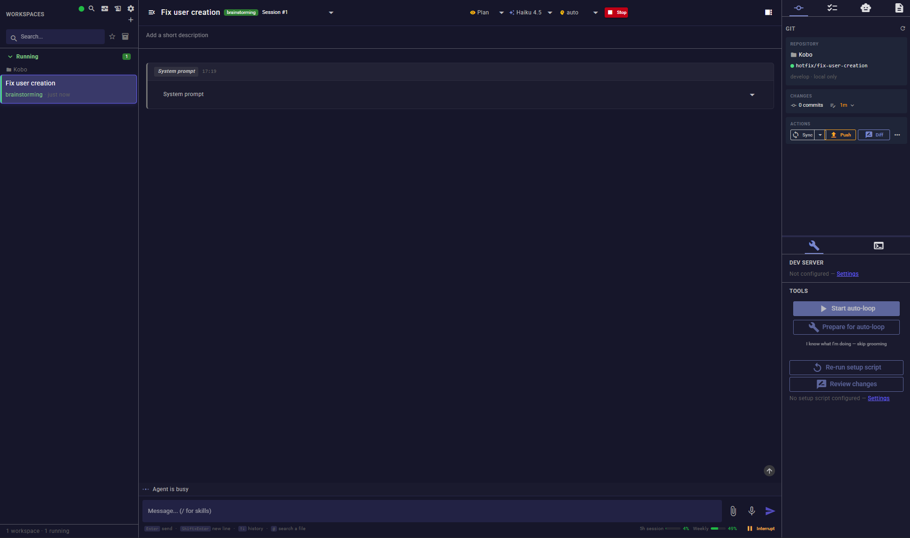
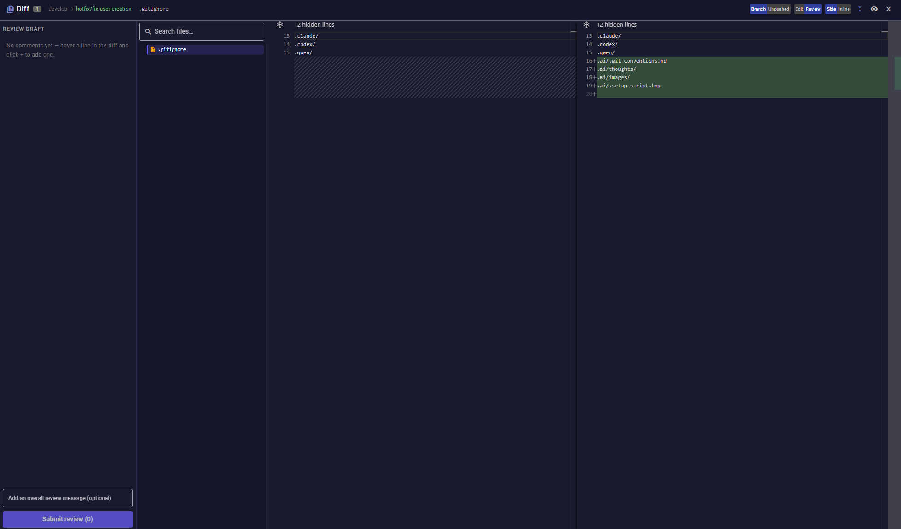

# Kōbō

**Run coding agents in parallel. Review their changes. Preview the result.**

[](https://www.npmjs.com/package/@loicngr/kobo)
[](https://github.com/loicngr/Kobo/actions/workflows/ci.yml)
[](https://nodejs.org/)
[](./LICENSE)

Kōbō (工房, “workshop”) is a self-hosted workspace for **Claude Code, OpenAI Codex and Mistral Vibe**. Give each coding mission its own Git worktree, agent conversations and task list. Follow the work live, inspect the diff, test the application and manage the pull request from one browser interface.

Run it on your computer or on your own server. Use your existing provider accounts, repositories and development commands. Kōbō is designed for a single operator managing several missions, with manual control and optional automation.

[Quick start](#quick-start) · [Features](#features) · [Live preview](#live-preview) · [Documentation](#documentation) · [Contributing](#contributing)



## Quick start

You need **Node.js 26.12.1 or later**, **Git**, **Bash**, a local Git repository and authentication for at least one supported engine. Mistral Vibe requires a separate installation; see [agent runtimes](#agent-runtimes).

```bash
npx @loicngr/kobo@latest
```

Open **<http://localhost:3000>** and follow the first-run setup:

1. Choose an engine and a project folder, then check the environment.
2. Create a mission with an objective and acceptance criteria.
3. Review the plan, select the appropriate execution permissions and ask the agent to implement it.
4. Review the changes, run the project and publish when ready.

A basic mission needs no Docker, skill plugin, forge CLI or ticket integration. The first-run check does not launch an agent. New installations default to the **Standard** skill suite, manual Git publication preferences and Plan permissions for Claude Code/Codex, or Interactive permissions for Vibe.

[Follow the first-mission guide →](./docs/getting-started.md)

> [!NOTE]
> This README describes `develop`, which can be ahead of the latest npm release. Embedded previews are currently an unreleased feature. See the [changelog](./CHANGELOG.md) for published changes, or [run from source](./CONTRIBUTING.md#setup).

## Why Kōbō

Coding agents can implement a change, but parallel work also needs organization: which checkout belongs to which task, what is waiting for your input, what changed, and what is ready to review.

Kōbō keeps those pieces together. A workspace follows a mission from its initial prompt through implementation, verification and review. You can move between missions without switching branches in your main checkout, continue with another model, or return later to the conversation and Git state.

| Capability | What it gives you |
|---|---|
| **Parallel workspaces** | Separate worktrees and branches for coding missions, with their own sessions, tasks and dev servers. |
| **Multiple agent engines** | Claude Code, Codex and experimental Mistral Vibe support, with engine-specific models and permissions. |
| **Review and editing** | Live conversations, Monaco diffs, inline comments, file editing and conflict resolution. |
| **Live application preview** | Chat beside the running application, or preview on its own, with resizable panels and mobile switching. |
| **Optional automation** | Task-driven auto-loop, independent final review, schedules, quota waits and lifecycle hooks. |
| **Persistent context** | Searchable conversations, pinned messages, handoffs and shared memory across engines. |

Worktrees isolate checkouts. They do **not** isolate processes, credentials, ports or databases; configure each project's environment accordingly.

## Features

### Follow several missions

Create a workspace from a prompt, a Notion page, a Sentry issue or an existing pull/merge request. Add screenshots, text files or PDFs to the mission or chat. Organize workspaces with tags and status filters, send group instructions, or compare two workspaces side by side.

The interface surfaces pending questions, CI failures, requested changes and merge readiness. Live output, reasoning, tool activity and agent-reported progress help you see what each session is doing. Search conversations globally, pin useful messages, and use the command palette to navigate.

### Review and deliver changes

Inspect changes side by side or inline in the Monaco diff viewer. Add review comments, edit files and resolve conflicts before using the Git panel to synchronize, push or open a pull request. GitHub, GitLab and Bitbucket Community integrations use the configured forge and credentials; repositories without a forge remain usable.

Run an independent review session when you want another agent to inspect the work. Use the integrated terminal for project commands alongside the conversation.

Git workflow preferences control requested commit, push and publication behavior. Engine permissions remain a separate control, and your explicit instructions still apply.



### Live preview

Start the workspace's dev server from **Tools**, then select **Preview** on its card or use the layout menu beside **Configure** in the workspace header. Preview controls appear while the server is running.

| View | Use it to |
|---|---|
| **Chat** | Work with the agent using the normal conversation layout. |
| **Chat + preview** | Test the application while asking for changes; drag the divider to adjust the balance. |
| **Preview** | Give the application the available workspace area while keeping access to the side drawers. |

The workspace list and right drawer remain independent. Width preferences are saved in your browser. On mobile or in a narrow workspace, switch between Chat and Preview rather than squeezing them into columns. The **×** button restores the previous drawer layout without stopping the server or losing the chat draft. Stopping the server returns you to Chat.

Local previews support native dev processes and Docker-published ports. For a VPS, an optional authenticated gateway and Traefik configuration make the server-side application reachable through HTTPS. Remote setup requires DNS/TLS configuration; a VPS `localhost` URL is not reachable directly from your home browser.

[Set up local, Docker or VPS previews →](./docs/dev-server-preview.md)

### Automate with explicit controls

Auto-loop works through tasks and acceptance criteria, tracks progress and pauses when it needs input or cannot make progress. An optional independent final review sends findings back for correction. Cron schedules, one-shot wakeups and lifecycle scripts support recurring work and project-specific checks.

Quota handling follows the selected engine's reported limits. Concurrency settings limit unattended starts. Manual sessions do not restart solely because a quota resets, and enabling automation does not silently elevate Plan permissions.

[Automation and recovery](./CONFIGURATION.md#auto-loop-completion-and-recovery) · [Final review](./CONFIGURATION.md#final-review-for-auto-loop) · [Concurrent agents](./CONFIGURATION.md#concurrent-agents)

### Fresh sessions and LLM handoffs

Use **Continue in a fresh session** or **Change LLM** to continue a mission with a fresh conversation, another model or another engine. Keep the worktree, task list and history, and choose whether the current agent generates a handoff or Kōbō assembles context without another provider call.

[Handoff behavior, permissions and recovery →](./CONFIGURATION.md#fresh-sessions-and-llm-handoffs)

### Context, tools and integrations

- **Persistent memory:** global, project and workspace knowledge shared across engines, with Manual, Hybrid and Automatic modes. Hybrid asks for approval before shared project/global changes.
- **MCP access:** managed agent tools and separately authorized external clients can work with tasks, conversations, workspace creation, lifecycle operations and progress reporting.
- **Optional integrations:** Notion, Sentry, forge tools and local voice transcription through `whisper.cpp`.
- **Skill suites:** Standard works without extensions; optional Superpowers, gstack, ECC and custom instructions reuse skills installed for the chosen engine.
- **Account controls:** optional `ccswap` integration switches Claude Code or Codex credentials; account changes are provider-wide, not isolated per workspace.
- **Lifecycle and storage:** hooks, workspace presets, conversation retention, worktree purge/restore and session diagnostics help manage longer-running installations.

[Configuration reference →](./CONFIGURATION.md) · [MCP guide →](./src/mcp-server/README.md)

## Agent runtimes

| Engine | Runtime and authentication | Notes |
|---|---|---|
| **Claude Code** | Embedded SDK runtime; authenticate with `claude /login` or `ANTHROPIC_API_KEY`. | A separately installed Claude CLI is not required for Kōbō's runtime. |
| **OpenAI Codex** | `codex app-server`; authenticate with `codex login` or `OPENAI_API_KEY`. | Each active workspace session uses its own native conversation. |
| **Mistral Vibe** | Separately installed and authenticated Vibe, with `vibe-acp` on the server user's PATH. | Experimental ACP integration; native Interactive permissions by default, no Plan mode. |

All three engines use Kōbō's task tracking, memory and managed MCP tools. Permissions and capabilities differ: Vibe does not support live steering, managed skill suites, account/quota controls or sub-agent cards. A review prompt is not a filesystem sandbox.

Kōbō does not include provider subscriptions or credits. Authenticate tools on the machine running the server, including inside the container for Docker installations.

[Runtime setup](./CONFIGURATION.md#agent-runtimes) · [Permission modes](./CONFIGURATION.md#permission-modes)

## Deployment

| Mode | Where the work runs | Guide |
|---|---|---|
| **Local** | On your computer, with loopback access by default. | [Quick start](#quick-start) |
| **Docker** | Inside your configured container environment, with persistent data and project mounts. | [Docker configuration](./CONFIGURATION.md#docker-deployment) |
| **Own VPS** | On your server, accessed from your browser over HTTPS through Traefik. | [VPS installation and updates](./docs/deployment-vps.md) |
| **From source** | Backend and frontend development processes, with a separate development data home. | [Contributing](./CONTRIBUTING.md#setup) |

The production frontend is an installable PWA. The mobile interface uses the same server and workspaces; it does not move agent execution onto your phone.

### Configuration

Settings support global defaults and per-project overrides for worktrees, dev-server commands, prompts, integrations and Git workflow preferences.

| Environment variable | Default | Purpose |
|---|---|---|
| `SERVER_PORT` / `PORT` | `3000` | Server port; `SERVER_PORT` takes precedence. |
| `KOBO_HOME` | `$XDG_CONFIG_HOME/kobo` or `~/.config/kobo` | SQLite database, settings and other persistent state. |
| `KOBO_PREVIEW_DOMAIN` | Unset | Enable the optional remote preview gateway; requires the documented HTTPS setup. |

```bash
SERVER_PORT=9997 npx @loicngr/kobo@latest
```

[Full settings and environment reference →](./CONFIGURATION.md)

### Security and data

Kōbō is a **single-user development tool**, not a multi-tenant service. It binds to `127.0.0.1` by default. Optional network access uses an operator token and browser sessions; internet-facing deployments require the documented reverse-proxy configuration.

Agents and project commands run with the server account's privileges and the selected engine's permissions. Conversations are stored locally, but agents send applicable context to their provider. Back up the data home and repositories before upgrading; database migrations do not replace a full backup.

[Security model and private vulnerability reporting →](./SECURITY.md)

## Documentation

| Guide | Covers |
|---|---|
| [Getting started](./docs/getting-started.md) | Requirements, first-run setup and your first mission. |
| [Configuration](./CONFIGURATION.md) | Settings, engines, integrations, automation and environment variables. |
| [Dev-server previews](./docs/dev-server-preview.md) | Layouts, mobile behavior, local/Docker setup and authenticated remote previews. |
| [VPS deployment](./docs/deployment-vps.md) | Installation, HTTPS, credentials, backups and updates. |
| [VPS projects and skills](./docs/vps-projects-and-skills.md) | Project environments, remote dev servers and container-side tools. |
| [MCP](./src/mcp-server/README.md) | Agent tools, external clients and scoped authorization. |
| [Troubleshooting](./docs/troubleshooting.md) | Environment checks, recovery and common problems. |
| [Contributing](./CONTRIBUTING.md) | Development setup, quality checks and release workflow. |
| [Architecture and agent guidance](./AGENTS.md) | Code organization, data model, migrations and engine contracts. |
| [Changelog](./CHANGELOG.md) | Published release history. |

## Architecture

TypeScript throughout: **Hono** serves HTTP APIs, **Vue 3 + Quasar** provides the PWA, **SQLite in WAL mode** stores workspace state, and **WebSockets** carry live updates. Engine adapters manage native agent sessions; managed MCP tools call the backend's authorization and services.

```text
src/
├── server/       # APIs, persistence, engine adapters and workspace services
├── client/       # Vue + Quasar interface and client tests
├── mcp-server/   # Workspace stdio bridge and managed tool handlers
├── shared/       # Shared contracts, model catalogues and utilities
└── __tests__/    # Backend tests and fixtures
```

## Contributing

Development happens on `develop`. Start with the [contributing guide](./CONTRIBUTING.md) and [design system](./DESIGN.md), then run the local CI pipeline before opening a pull request:

```bash
make ci
```

It installs and audits all three dependency trees, checks formatting and types, builds the application, runs backend/client/deployment tests, and installs and smoke-tests the packaged tarball. Deployment tests require Python 3.10+ and OpenSSL; native dependencies may require a compiler toolchain.

Linux is locally exercised and CI includes Linux/macOS jobs. See the [compatibility notes](./docs/getting-started.md#requirements) for limits; do not assume native Windows support.

## Community and support

Use [GitHub Issues](https://github.com/loicngr/Kobo/issues) for reproducible bugs and feature requests. Follow the [Code of conduct](./CODE_OF_CONDUCT.md). Report vulnerabilities through the [private security channel](./SECURITY.md#report-privately), not public issues. Support is provided on a best-effort basis.

## License

[GPL-3.0-or-later](./LICENSE). See [third-party notices](./THIRD_PARTY_NOTICES.md) for redistributed assets.
